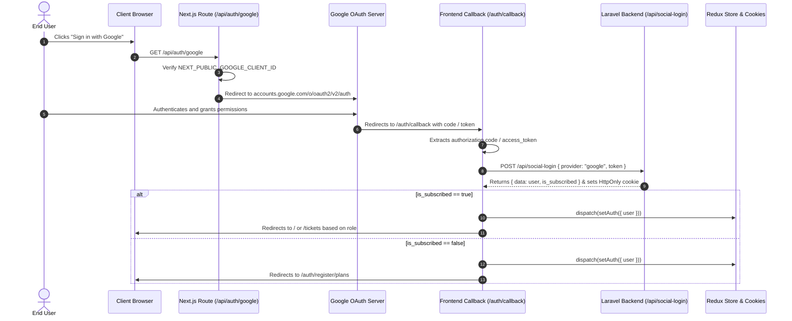
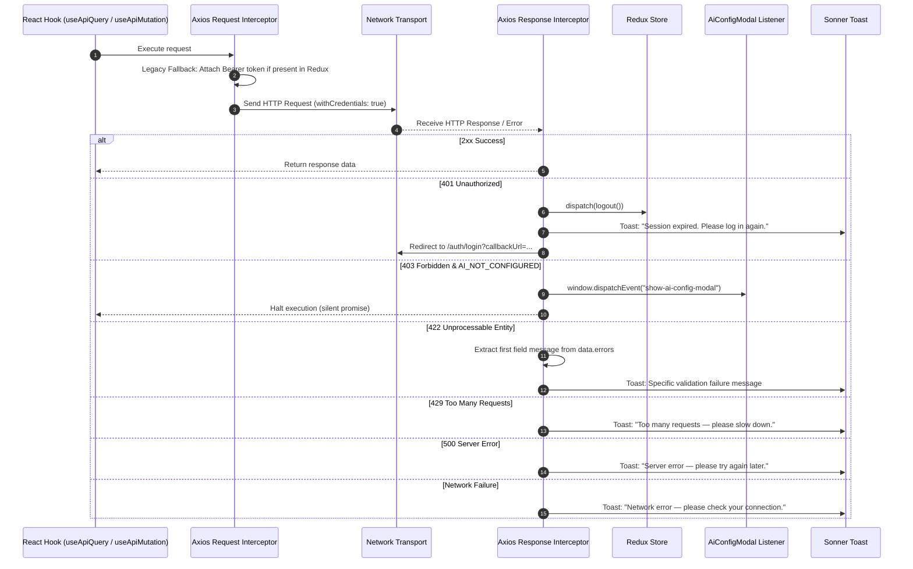

# Frontend Architecture: Tixolve / Illogre

Comprehensive architectural guide detailing data flow, routing guards, state management, session handling, API interceptors, and Next.js 16 conventions.

---

## 1. High-Level Architecture & Data Flow

```mermaid
flowchart TD
    subgraph Browser ["Client Browser"]
        UserAction["User Interaction"]
        NextProxy["Next.js 16 Proxy (src/proxy.ts)"]
        RootLayout["RootLayout (Providers)"]
        DashboardLayout["DashboardLayout Gatekeeper"]
        Views["Page Components / UI Views"]
        ReduxStore["Redux Store (authSlice)"]
        QueryCache["TanStack Query Cache"]
        AxiosClients["Axios (Public / Private)"]
    end

    subgraph Backend ["Laravel API Server"]
        ApiEndpoint["/api/* Endpoints"]
        AuthService["Auth & Session Controller"]
        HttpOnlyCookie["HttpOnly Cookie: tixolve_access_token"]
    end

    UserAction --> NextProxy
    NextProxy --> RootLayout
    RootLayout --> DashboardLayout
    DashboardLayout -->|Auth & AI Checks Pass| Views
    Views -->|Read State| ReduxStore
    Views -->|Query / Mutate| QueryCache
    QueryCache --> AxiosClients
    AxiosClients -->|HTTP withCredentials: true| ApiEndpoint
    ApiEndpoint -->|Set-Cookie: tixolve_access_token| HttpOnlyCookie
    HttpOnlyCookie -.->|Automatic Browser Attachment| AxiosClients
    AxiosClients -->|401 Unauthorized| ReduxStore
    AxiosClients -->|403 AI_NOT_CONFIGURED| DashboardLayout
    AxiosClients -->|Success Payload| QueryCache
    QueryCache -->|Re-render with Fresh Data| Views
```



---

## 2. Directory & File Structure

```
illogry-frontend/
├── .env                              # Local environment variables
├── .env.production                   # Production environment overrides
├── components.json                   # Shadcn UI configuration file
├── eslint.config.mjs                 # ESLint 9 flat configuration
├── next.config.ts                    # Next.js standalone build & header settings
├── package.json                      # Dependencies and npm scripts
├── tsconfig.json                     # TypeScript compiler configuration
├── vercel.json                       # Static / rewrite route rules
├── public/                           # Static public files & favicons
│   ├── tixolve_logo.ico              # Platform favicon
│   └── *.svg                         # Default SVGs
└── src/
    ├── proxy.ts                      # Next.js 16 Proxy / Middleware implementation
    ├── app/                          # Next.js App Router route hierarchy
    │   ├── layout.tsx                # Root layout (Fonts, Providers, Toaster)
    │   ├── globals.css               # Tailwind CSS v4 styling, tokens & theme
    │   ├── error.tsx                 # Root runtime error boundary
    │   ├── not-found.tsx             # Global 404 page
    │   ├── terms-and-conditions/     # Public terms and conditions
    │   ├── accept-invitation/        # Public team invite acceptance ([token])
    │   ├── accept-agent-invitation/  # Public agent invite acceptance
    │   ├── api/                      # Next.js Server Route Handlers
    │   │   └── auth/google/route.ts  # Google OAuth2 authorization redirector
    │   ├── auth/                     # Authentication & onboarding route group
    │   │   ├── layout.tsx            # Minimal auth shell
    │   │   ├── login/                # Email/Password & Google login
    │   │   ├── register/             # Registration wizard (company, OTP, plans)
    │   │   ├── forgot_password/      # 3-step OTP password reset
    │   │   ├── callback/             # Google OAuth callback handler
    │   │   ├── accept-invitation/    # Team invitation handler ([token])
    │   │   └── accept-agent-invitation/ # Support agent invitation handler
    │   └── (dashboard)/              # Protected application views
    │       ├── layout.tsx            # Protected shell, auth & AI gatekeeper
    │       ├── page.tsx              # Executive Overview dashboard
    │       ├── tickets/              # Ticket queue & conversation view ([id])
    │       ├── knowledge_base/       # Knowledge source indexing & testing ([id])
    │       ├── ai_automation/        # AI confidence & mode configuration
    │       ├── customers/            # Customer directory & details ([id])
    │       ├── analytics/            # Operational analytics & reports
    │       ├── integrations/         # Shopify, Email, Slack, WhatsApp hub
    │       ├── team/                 # Member roster & role assignment
    │       ├── billing/              # Subscription, plans, Stripe portal
    │       ├── settings/             # Workspace, general, security settings
    │       └── forbidden/            # 403 access restricted fallback page
    ├── assets/                       # Static images, partner logos (Shopify, Gmail, etc.)
    ├── components/                   # UI components organized by domain
    │   ├── ui/                       # Reusable primitives (button, dialog, input, etc.)
    │   ├── svg/                      # Inline SVG iconography components
    │   ├── shared/                   # Cross-cutting modals (AiConfigModal, ActionModal)
    │   ├── dashboard/                # Charts and tables for Overview page
    │   ├── ticket/                   # Ticket header, chat, AI analysis, customer panel
    │   ├── TicketsComponents/        # Tickets data table
    │   ├── knowledge-base/           # Source cards, stats, test query view, modals
    │   ├── automation/               # QuickSetupConfig, rule cards, permissions
    │   ├── customers/                # Customer table, detail view, edit modals
    │   ├── analytics/                # Recharts analytics visualizations
    │   ├── integrations/             # Integration cards, Shopify connect modals
    │   ├── team/                     # Team member table, invite & edit modals
    │   ├── billing/                  # Active plan cards, usage gauges, history
    │   ├── settings/                 # General, workspace, AI, security, Google tabs
    │   ├── notifications/            # NotificationPopover header widget
    │   ├── login/                    # LoginForm component
    │   ├── register/                 # RegisterForm, EmailVerification components
    │   └── forgot_password/          # ForgotPasswordFlow component
    ├── hooks/                        # Custom hooks & API domain services
    │   ├── axios/
    │   │   ├── useAxiosPublic.tsx    # Unauthenticated HTTP client
    │   │   └── useAxiosPrivate.tsx   # Authenticated client with interceptors
    │   ├── mutation/
    │   │   └── useApiMutation.tsx    # TanStack Query useApiQuery & useApiMutation
    │   ├── auth.api.ts               # Auth, registration, session, OTP hooks
    │   ├── tickets.api.ts            # Ticket list, details, reply, notes hooks
    │   ├── knowledge-base.api.ts     # Knowledge source CRUD, test query hooks
    │   ├── automation.api.ts         # Automation mode & threshold settings hooks
    │   ├── customers.api.ts          # Customer directory CRUD hooks
    │   ├── analytics.api.ts          # Analytics reporting hooks
    │   ├── owner.api.ts              # Overview metrics, integrations, Shopify hooks
    │   ├── team.api.ts               # Team member roster & invite hooks
    │   ├── billing.api.ts            # Billing overview, portal, cancellation hooks
    │   ├── pricing.api.ts            # Pricing plans & Stripe checkout hooks
    │   ├── settings.api.ts           # Workspace & system configuration hooks
    │   └── notifications.api.ts      # Notifications polling & read status hooks
    ├── lib/                          # Utility functions and domain types
    ├── provider/                     # ReduxProvider, QueryProvider
    ├── shared/                       # Header, Sidebar, LogoutModal
    ├── store/                        # Redux store and authSlice
    ├── types/                        # API types (QueryOptions, MutationOptions)
    └── utils/                        # Cookie, storage wrappers, validator
```

---

## 3. Next.js 16 File Conventions & Proxy Middleware

This repository utilizes **Next.js 16.2.2**. In Next.js 16, proxy/middleware functionality is declared via `src/proxy.ts`, which Next.js compiles as `Proxy (Middleware)`:

```typescript
// Verified in src/proxy.ts
import { NextResponse } from "next/server";
import type { NextRequest } from "next/server";

export function proxy(request: NextRequest) {
  const token = request.cookies.get("tixolve_access_token")?.value;
  const { pathname } = request.nextUrl;

  // In cross-origin deployments (frontend on port 3000 / frontend domain and
  // backend on api domain), the Next.js edge/server runtime does not receive the
  // HttpOnly authentication cookie set by the backend.
  // Therefore, middleware/proxy cookie checks serve as preliminary routing hints only.
  // Definitive authentication verification is performed by protected layouts and pages
  // validating against GET /api/user.
  if (
    token &&
    pathname === "/auth/login" &&
    !request.nextUrl.searchParams.has("callbackUrl") &&
    !request.nextUrl.searchParams.has("error")
  ) {
    return NextResponse.redirect(new URL("/", request.url));
  }

  return NextResponse.next();
}

export const config = {
  matcher: ["/((?!api|_next/static|_next/image|favicon.ico).*)"],
};
```

### Route Protection Realities & Limitations
- **Preliminary Hint Only**: In cross-origin deployments, `request.cookies.get("tixolve_access_token")` cannot read the backend's HttpOnly cookie. Therefore, edge middleware cannot guarantee authentication.
- **Definitive Gatekeeper**: True route protection is executed client-side by `DashboardLayout` via `useCurrentUser()` (`GET /api/user`).
- **Subscription Check**: Owners with `is_subscribed === false` attempting to access any route other than `/billing` are redirected to `/auth/register/plans`.
- **AI Configuration Block**: If `is_ai_configured === false`, restricted routes (`/tickets`, `/customers`, `/ai_automation`, `/knowledge_base`) suppress page content and trigger `AiConfigModal`.

---

## 4. Authentication Architecture & Security Model

### 1. HttpOnly Cookie Mechanism
- The Laravel backend issues `tixolve_access_token` with the `HttpOnly` flag.
- The browser automatically attaches this cookie on cross-origin requests to the API domain when `withCredentials: true` is configured in Axios.
- **JavaScript Inaccessibility**: Frontend JavaScript **cannot access or read** `tixolve_access_token` through `document.cookie`.
- **Token Absence in Client Storage**: Tokens are completely absent from `localStorage`, `sessionStorage`, client-accessible cookies, and Redux state.
- **Logout Requirement**: Because JavaScript cannot delete an HttpOnly cookie, `useLogout()` in `src/hooks/auth.api.ts` must call `POST /api/auth/logout`. The server invalidates the session and returns a `Set-Cookie` header with an expired timestamp.
- **Non-Sensitive User Metadata Cookie**: Frontend JavaScript writes a 7-day cookie named `tixolve_access_user` containing serialized user profile data (`{ id, name, email, role, is_verified, is_ai_configured }`) to hydrate Redux state on initial render before `/api/user` resolves.

### 2. Infrastructure & CORS Requirements
Configuring `withCredentials: true` on the frontend does **not** ensure security on its own. The production environment requires:
- **CORS Credentials**: Backend must set `Access-Control-Allow-Credentials: true`.
- **Explicit Allowed Origin**: Backend must set `Access-Control-Allow-Origin: <frontend_origin>` (Wildcards `*` are disallowed when credentials are true).
- **Cookie Flags**: When frontend and backend reside on different domains, the backend must set `SameSite=None; Secure`, requiring HTTPS.
- **Subdomain Sharing**: When frontend and backend share a parent domain (e.g., `app.tixolve.com` and `api.tixolve.com`), cookies should specify `Domain=.tixolve.com`.

### 3. Google OAuth 2.0 Integration Flow



---

## 5. State Management Architecture

State is divided between **Client State** (managed by Redux Toolkit) and **Server State** (managed by TanStack React Query):

```
┌────────────────────────────────────────────────────────────────────────┐
│                        Application State Schema                        │
├──────────────────────────────────┬─────────────────────────────────────┤
│      Redux Toolkit (Client)      │      TanStack Query (Server)        │
│  File: src/store/slices/authSlice │  Hooks: src/hooks/*.api.ts          │
├──────────────────────────────────┼─────────────────────────────────────┤
│  State Shape:                    │  Active Query Keys:                 │
│  {                               │  - ["current-user"]                 │
│    user: UserState | null,       │  - ["shared-tickets", params]       │
│    token: null,                  │  - ["ticket-details", id]           │
│    remember: boolean             │  - ["knowledge-base-list"]          │
│  }                               │  - ["automation-settings"]          │
│                                  │  - ["owner-customers", params]      │
│  Actions:                        │  - ["analytics", range]             │
│  - setAuth({ user, remember })   │  - ["team-overview"]                │
│  - setUser(user)                 │  - ["integrations"]                 │
│  - logout()                      │  - ["billing-overview"]             │
│                                  │  - ["settings"]                     │
│  Persistence:                    │  - ["notifications-list"]           │
│  Cookie: 'tixolve_access_user'   │                                     │
│  (Non-sensitive user metadata)   │  Polling Strategies:                │
│                                  │  - Tickets List: 1000ms interval    │
│                                  │  - Ticket Details: 5000ms interval  │
│                                  │  - Notifications: 30000ms interval  │
└──────────────────────────────────┴─────────────────────────────────────┘
```

### Store Injection Pattern
To allow Axios response interceptors to dispatch Redux actions (such as `logout()`) without circular imports, `src/hooks/axios/useAxiosPrivate.tsx` exports `injectStore`:
```typescript
let storeInstance: AppStore | null = null;
export const injectStore = (s: AppStore) => { storeInstance = s; };
```
`ReduxProvider` calls `injectStore(store)` on mount.

---

## 6. API Request / Response Interceptor Pipeline



### Legacy Bearer Token Fallback
In `src/hooks/axios/useAxiosPrivate.tsx`, the request interceptor inspects `store.getState().auth.token`:
```typescript
const token = store.getState().auth.token;
if (token) {
  config.headers.Authorization = `Bearer ${token}`;
}
```
In standard operation, `state.token` is `null` because the backend uses HttpOnly cookies. This interceptor remains strictly as a legacy fallback.

---

## 7. Knowledge Base Data Flow & Retrieval Architecture

The Knowledge Base implementation operates as a **text-indexed document retrieval system**:

```
┌────────────────────────────────────────────────────────────────────────┐
│                      Knowledge Base Retrieval Flow                     │
├────────────────────────────────────────────────────────────────────────┤
│  1. Document Upload: Multi-part file (PDF/TXT) or raw text ingested.   │
│  2. Processing: Backend parses document and creates text chunks.       │
│  3. Status Display: Status updates from 'Processing' to 'Indexed'.     │
│  4. Test Query Console: User queries input via SourceDetailView.       │
│  5. API Call: POST /api/{prefix}/knowledge-base/{id}/test-query        │
│  6. Response Contract:                                                 │
│     {                                                                  │
│       ai_response: "Generated answer text...",                         │
│       sources_used: {                                                  │
│         response_time: "1.2s",                                         │
│         model: "gpt-4o",                                               │
│         embedding: "Text-Indexed"                                      │
│       }                                                                │
│     }                                                                  │
└────────────────────────────────────────────────────────────────────────┘
```

> [!NOTE]
> The frontend contract displays text-indexed retrieval status. Vector database storage or semantic search capabilities are handled entirely within the backend system and are not directly exposed or managed by frontend application code.
